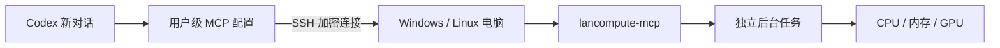

# lancompute-mcp

通过 MCP 使用局域网电脑的 CPU、内存和 GPU，运行编译、测试、Python 脚本和其他计算任务。以 Windows 为主要使用场景，也支持 Linux。

在运行 Codex 的主机中配置一次，后续新对话即可使用；Windows 电脑需要保持在线。服务通过 **SSH + MCP stdio** 连接，无需额外开放 HTTP 端口。



它提供任务执行能力。GPU 任务仍需要在计算机上安装驱动和相应框架，例如 PyTorch；当前对话模型的服务端推理不会因此迁移到本机。

## 功能

| 工具 | 用途 |
| --- | --- |
| `get_system_info` | 查询系统、CPU、可用内存、磁盘、Python 路径和 NVIDIA GPU（若可用） |
| `write_file` | 上传脚本、配置或小型输入文件，支持文本和 base64 |
| `read_file` | 分块读取结果文件，支持文本和 base64 |
| `start_job` | 提交后台任务，立即返回任务 ID |
| `get_job` | 查询任务状态、退出码和 stdout/stderr 日志末尾 |
| `list_jobs` | 列出最近任务 |
| `cancel_job` | 请求停止任务及其子进程 |

后台任务由独立 worker 执行，MCP 断开或结束对话后仍可运行。新对话使用相同账户和状态目录即可继续查询。电脑重启会中断任务，不会自动重跑。

Windows 会先请求脱离 SSH 会话的进程 Job Object；若系统禁止脱离，则尝试通过本机 CIM 服务创建 worker。这种回退需要账户具有相应的本机 WMI/CIM 权限，且不会继承 SSH 会话中临时设置的环境变量。两种方式均失败时会报告启动错误。

## Windows 安装

需要 Windows 10/11、Python 3.10+、Git 和 OpenSSH Server。建议把仓库放在没有空格的路径，例如 `C:\lancompute-mcp`。

### 1. 安装 MCP

在 Windows PowerShell 中执行：

```powershell
git clone https://github.com/chenkl112/lancompute-mcp.git C:\lancompute-mcp
cd C:\lancompute-mcp
powershell -NoProfile -ExecutionPolicy Bypass -File .\scripts\install-windows.ps1
```

脚本创建 `.venv`、安装依赖，并生成两个本机配置文件：

- `start-mcp.local.cmd`：供 SSH 启动服务，无需激活虚拟环境。
- `codex-config.local.toml`：包含实际路径的 Codex MCP 配置。

安装脚本无需管理员权限；如果当前账户不能创建 `C:\lancompute-mcp`，可以换成用户目录。以下命令使用真实安装路径替换示例路径。

可指定工作目录：

```powershell
powershell -NoProfile -ExecutionPolicy Bypass -File .\scripts\install-windows.ps1 -Workspace D:\Compute
```

### 2. 启用 SSH

以管理员身份打开 PowerShell，执行：

```powershell
powershell -NoProfile -ExecutionPolicy Bypass -File C:\lancompute-mcp\scripts\enable-ssh.ps1
```

脚本安装并启用 OpenSSH Server，设置开机启动，防火墙仅允许本地子网访问 TCP 22。记下 Windows 用户名和正在联网的网卡 IPv4 地址。

### 3. 配置 SSH 密钥

以下命令在**运行 Codex 的主机**上执行。没有密钥时先生成一对：

```bash
ssh-keygen -t ed25519
cat ~/.ssh/id_ed25519.pub
```

把输出的**公钥**添加到 Windows 的授权文件中，不要复制私钥。密钥有口令时，需要先将其加入 Codex 进程能访问的 `ssh-agent`，例如 `ssh-add ~/.ssh/id_ed25519`。

普通 Windows 账户的公钥文件是 `%USERPROFILE%\.ssh\authorized_keys`。Windows OpenSSH 默认配置中，Administrators 组账户使用 `C:\ProgramData\ssh\administrators_authorized_keys`；以管理员身份创建或编辑该文件，确保每个公钥占一行，然后执行：

```powershell
icacls C:\ProgramData\ssh\administrators_authorized_keys /inheritance:r
icacls C:\ProgramData\ssh\administrators_authorized_keys /grant:r "*S-1-5-32-544:F" "*S-1-5-18:F"
```

参考 [Windows OpenSSH 密钥管理](https://learn.microsoft.com/windows-server/administration/openssh/openssh_keymanagement)。首次密码登录使用 Windows 账户密码，不能使用 Windows Hello PIN。

在 Codex 主机的 `~/.ssh/config` 中添加：

```sshconfig
Host lancompute-windows
    HostName 192.168.1.100
    User YOUR_WINDOWS_USER
    IdentityFile ~/.ssh/id_ed25519
    IdentitiesOnly yes
    BatchMode yes
    ConnectTimeout 10
    ServerAliveInterval 30
    ServerAliveCountMax 3
```

替换 IP、用户名和密钥路径。首次手动连接，核对 Windows 主机指纹并接受后，再验证无需交互即可登录：

```bash
ssh -o BatchMode=no lancompute-windows whoami
ssh -T -o BatchMode=yes lancompute-windows whoami
```

两个命令都应返回 Windows 账户名。不要跳过主机指纹校验。

### 4. 注册到 Codex 的所有新对话

在**运行 Codex 的主机**上，将 Windows 生成的 `codex-config.local.toml` 内容加入 `~/.codex/config.toml`。示例：

```toml
[mcp_servers.lancompute]
command = "ssh"
args = ["-T", "-o", "BatchMode=yes", "-o", "ConnectTimeout=10", "lancompute-windows", 'cmd.exe /d /c "C:/lancompute-mcp/start-mcp.local.cmd"']
startup_timeout_sec = 30
tool_timeout_sec = 60
```

也可以使用 Codex CLI 注册（Linux/bash 终端示例）：

```bash
codex mcp add lancompute -- ssh -T -o BatchMode=yes -o ConnectTimeout=10 lancompute-windows 'cmd.exe /d /c "C:/lancompute-mcp/start-mcp.local.cmd"'
codex mcp list
```

两种方式选择一种。关闭并重新打开对话以加载新增 MCP。只有使用这份用户级配置、允许该 MCP 的 Codex 客户端会加载它。项目策略、客户端权限和连接状态仍可能影响调用。

上面的启动命令适用于 Windows OpenSSH 的默认 `cmd.exe` shell；若修改了 `DefaultShell`，需要相应调整启动命令。SSH 登录脚本不得向 stdout 输出欢迎语，否则会干扰 MCP 协议。

## 使用示例

在新对话中说：

> 用 lancompute 查看我的电脑配置，把这个 Python 计算脚本传过去后台运行，然后检查结果。

客户端可以按以下顺序调用：

1. `get_system_info()`：确认目标电脑和 Python 环境。
2. `write_file(path="scripts/hello.py", content="print('你好，局域网算力')")`。
3. `start_job(command="& 'C:/lancompute-mcp/.venv/Scripts/python.exe' scripts/hello.py")`。
4. 使用返回的 `job_id` 调用 `get_job`，检查 `status`、`exit_code` 和日志。

Python 命令请使用 `get_system_info` 返回的 `python_executable`，或你安装了计算框架的其他 Python 环境的绝对路径。SSH 会话不会自动激活终端里使用的 Conda 环境。

默认 shell 是 Windows PowerShell（优先使用已安装的 `pwsh`），Linux 默认使用 bash；也可指定 `shell="powershell"`、`"bash"` 或 Windows 的 `"cmd"`。默认超时 3600 秒，可以设置 1 秒至 7 天。任务状态包括 `queued`、`running`、`succeeded`、`failed`、`cancelled`、`timed_out` 和 `interrupted`。取消为异步操作，调用后继续查询最终状态。

## 工作目录与权限

| 环境变量 | 默认值 |
| --- | --- |
| `LANCOMPUTE_WORKSPACE` | `~/lancompute-workspace` |
| `LANCOMPUTE_STATE_DIR` | `~/.lancompute-mcp` |

文件工具和任务 `cwd` 限定在工作目录中，拒绝 `..` 和符号链接越界。**这不是命令执行沙箱**：提交的命令拥有 SSH 登录账户的全部权限。请使用你信任的客户端和合适的 Windows 账户。

单次写入最多 4 MiB，单次读取最多 128 KiB。读取大文件时按 `next_offset` 继续；要完整还原二进制或分块 UTF-8，请使用 `encoding="base64"`。更大的输入数据建议通过 SCP 或共享目录传输。

每个任务的元数据、完整 stdout/stderr 保存在状态目录的 `jobs/<job_id>/` 中，日志查询只返回末尾，避免一次加载全部日志。日志不会自动删除，长期运行时请定期清理**已结束**任务的目录。当前版本没有并发数量或 CPU/GPU 配额限制，提交多个任务会共享机器资源。

## Linux 安装

在提供算力的 Linux 主机上：

```bash
git clone https://github.com/chenkl112/lancompute-mcp.git
cd lancompute-mcp
python3 -m venv .venv
.venv/bin/pip install -e .
```

配置 SSH 免交互登录后，在 Codex 主机注册绝对路径：

```bash
codex mcp add lancompute -- ssh -T -o BatchMode=yes YOUR_LINUX_SSH_ALIAS /absolute/path/lancompute-mcp/.venv/bin/lancompute-mcp
```

MCP 也可在同一台电脑直接启动：`codex mcp add lancompute -- /absolute/path/lancompute-mcp/.venv/bin/lancompute-mcp`。

## 开发与验证

```bash
python -m pip install -e '.[dev]'
ruff check .
ruff format --check .
pytest -q
```

测试覆盖文件传输、路径越界、真实任务执行、退出码、超时、取消及子进程终止、日志截断，以及 MCP stdio 握手、工具调用和断开后继续运行。GitHub Actions 配置了 Windows/Linux 与 Python 3.10/3.12 的测试矩阵。

Codex 配置参考：[官方 MCP 文档](https://developers.openai.com/codex/mcp/)。
